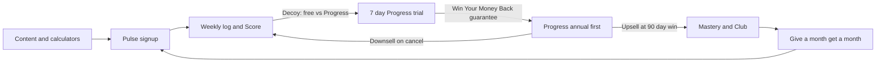

# Mosaic Finance — Living Roadmap

*Canonical. Last stage assessment: 13 October 2026.*
*Companion: [hormozi-playbook.md](./hormozi-playbook.md) (offer, leads, money model).*
*Full test checklist: [qa/full-test-run.md](./qa/full-test-run.md).*

---

## Agent protocol

Read this file before every task. If the task is offer, pricing, funnel, or marketing copy, also read [hormozi-playbook.md](./hormozi-playbook.md).

1. Confirm the current phase and do not skip ahead. Do not reorder phases without the owner.
2. When a task completes a checkbox, mark it `[x]` and add `YYYY-MM-DD · PR #n` on the same line.
3. Put anything noticed but out of scope under **Backlog**. Also list it in the PR under **Found but not fixed.**
4. One task, one branch (`agent/<short-task-name>`), one PR. Billing, entitlements, prices, and `MASTERY_PUBLIC` wait for an owner decision recorded in this file.
5. User-facing copy and AI prompts: list every changed string in the PR for compliance review. The Consistency Guarantee is conditioned only on weekly logging and monthly snapshots for 90 days, measured by the Financial Health Score.
6. Do not commit the `ah/` folder (copyrighted local reference).

---

## Outcome

**Know every week whether your money is moving the right direction.**

The live Financial Health Score plus weekly logging and the monthly net-worth snapshot is the product. The Progress Report is the paid layer that explains the picture — educational information, not advice. Pulse is free forever (tracks). Progress is paid (thinks). Mastery stays in code until the Club is ready.

---

## Stage assessment — 13 October 2026

Ops for a live charge is in place. The Grand Slam Offer is on the homepage. Still waitlist, no paying users. The remaining Phase 0 gate is the full test run (plus legal). Next build is Phase 1B.

| Lens | Stage | Evidence |
|---|---|---|
| Hormozi Scaling Roadmap | **Stage 0 (Improvise) graduating to Stage 1 (Monetize)** | Pulse + 7-day trial exist. Nobody has paid yet. Graduate Stage 0 when people use the free loop and come back. Graduate Stage 1 at the first paid Progress subscriber. |
| Money Model | **Pre-Stage I** | Attraction offer is designed **and presented** (homepage, PR #13 / #14). Not running against a paid cohort. No 30-day payback number yet. |
| Product | Built, not proven | Tiers, live Stripe prices in Vercel Production, Score history, Guarantee, founding counter, crons, nurture, Resend domain verified. New accounts land on the tracking dashboard (`39f4037`). |
| Offer surface | Shipped (1A) | Canonical copy in [src/lib/config/offer.ts](../src/lib/config/offer.ts). Hero is `OUTCOME_HEADLINE` + Guarantee. How It Works starts with "Log this week." Pricing defaults annual. |
| Launch surface | Waitlist | `NEXT_PUBLIC_LAUNCH_MODE` defaults to waitlist ([src/lib/config/launch.ts](../src/lib/config/launch.ts)). Hero badge still "Launching Soon · 200 founding spots" when not live. `MASTERY_PUBLIC = false`. Trial is **7 days**. |

**Gaps vs the playbook (code, not ideas):**

- No PostHog events in `src/` (only `@vercel/analytics`). Env keys exist in `.env.example`. Phase 1C.
- No referral code. Phase 1F / 5.
- Score savings / emergency / debt still come from the fact-find profile ([src/lib/health-score/record.ts](../src/lib/health-score/record.ts)), not from tracked data. Phase 1B.
- No weekly "you haven't logged" cron. Existing crons: nurture, education, trial-lifecycle, picks. Phase 1D.
- September docs ([BUSINESS_PLAN.md](../BUSINESS_PLAN.md), [BUSINESS_TODO.md](../BUSINESS_TODO.md)) are archived. Stale facts in those files: 14-day trial, Mastery shown on marketing, signup → onboarding as the default land.

---

## Phase 0 — Verify it runs

Owner ops (migrations, live Stripe, crons, webhook, Resend) are done. Exit: [qa/full-test-run.md](./qa/full-test-run.md) sign-off criteria are all true. Nothing in Phase 2 happens until then. Phase 1A already shipped in parallel; remaining Phase 1 is 1B–1E.

### Right now (owner / staging)

- [x] Apply migrations `027_tiers_pulse_progress_mastery.sql` and `028_entitlements_score_budgets_nurture.sql` (a human applies production). 2026-10-12 · owner
- [x] Create Stripe prices (CAD) and set env vars from `.env.example`: Progress $17 / $170, founding $8 / $80, Mastery $44 / $350, Academy $26 / $260. Owner chose live-mode prices and keys in Vercel Production. 2026-10-12 · owner
- [x] `NEXT_PUBLIC_LAUNCH_MODE` unset/waitlist. `FOUNDING_CAP=200` set. `FOUNDING_DEADLINE` empty until launch day. 2026-10-12 · owner
- [x] Vercel crons include `/api/cron/trial-lifecycle` and `/api/cron/nurture`; `CRON_SECRET` is set. 2026-10-12 · owner
- [x] Stripe **live** webhook: URL `/api/stripe/webhook`, events `customer.subscription.created/updated/deleted`, `checkout.session.completed`. (A GET in the browser returns 405 by design.) 2026-10-13 · owner
- [x] Verify Resend domain (SPF/DKIM). `mosaicfinance.ai` verified. Stop sending QA mail to `@mosaic-qa.test`; use real `+tag` inboxes or Resend test addresses. 2026-10-12 · owner
- [ ] Complete [qa/full-test-run.md](./qa/full-test-run.md) on staging. Note: auth now lands on `/dashboard` (not `/onboarding`). Trial is 7 days (not 14). Mastery is hidden on the public site. Update expected results where the checklist still says the old numbers.

### Parallel launch blockers (legal)

- [ ] Business entity and business bank account tied to Stripe.
- [ ] Real PIPEDA / Quebec Law 25 privacy policy and ToS on `/privacy` and `/terms`.
- [ ] Remove "portfolio demo" language from [README.md](../README.md) and any public surface before charging.
- [ ] CIPO search for "Mosaic Finance" and "The Money Mosaic".
- [ ] Confirm "Mosaic Academy" (never "University").

---

## Phase 1 — Implement the playbook upgrades

1A shipped (PR #13, hero tighten PR #14). Remaining: 1B–1E, then 1F after owner decisions. One branch per PR. Items tagged **Decision needed** wait for the owner. Compliance: every copy change listed in the PR.

### 1A — Offer surface (`agent/offer-guarantee-headline`)

Make the Grand Slam Offer visible. Details in [hormozi-playbook.md](./hormozi-playbook.md#our-grand-slam-offer).

- [x] Hero, pricing, and [TrackingLoop](../src/components/app/TrackingLoop.tsx): Consistency Guarantee is the headline, not grey supporting text. Condition: weekly log + monthly snapshot for 90 days, Score-based. Never returns or dollars saved. 2026-10-12 · PR #13
- [x] Name the bonuses from the archived plan: Canadian Money Mechanics Toolkit (calculators), Life-Event Playbooks, founding badge + locked $8. Tax pack and Club stay Mastery-only and stay off the public site. 2026-10-12 · PR #13
- [x] Restructure below-hero marketing to the Score loop (Outcome B). Files: [src/components/marketing/](../src/components/marketing/), page `<title>` in [src/app/layout.tsx](../src/app/layout.tsx). How It Works starts with "Log this week," not "Tell Charlie." 2026-10-12 · PR #13
- [x] Annual-first on pricing: default `billing` to `"annual"` in [pricing-section.tsx](../src/components/marketing/pricing-section.tsx). $170 is the 30-day payback vehicle. 2026-10-12 · PR #13

Canonical offer copy now lives in [src/lib/config/offer.ts](../src/lib/config/offer.ts) with a compliance guard in `tests/unit/offer-copy.test.ts`.

### 1B — Score loop (`agent/score-from-tracked-data`)

- [ ] `recordDerivedHealthScore` uses tracked outflow, savings lines, and snapshots when no fact-find exists; fact-find is the fallback, not the source of truth. Design the precedence, then add tests in `tests/unit/health-score.test.ts`.
- [ ] `DashboardGenerating` reuses `TrackingLoop` instead of six "Available after your Progress Report is ready" placeholders ([src/app/dashboard/page.tsx](../src/app/dashboard/page.tsx)).
- [ ] Quick-log or balance check on the dashboard home so "Log this week" is not a navigation to the 1,800-line cash-flow page.
- [ ] Update [tests/integration/user-journey.test.ts](../tests/integration/user-journey.test.ts) for dashboard-first landing.
- [ ] Pre-existing lint: `window.location.href` in signup; `Date.now()` in `DashboardDelivered`. Fix only if this PR already touches those files; otherwise leave in Backlog.

### 1C — Instrumentation (`agent/posthog-loop-events`)

IDs and counts only. No amounts, names, emails, or free-text.

- [ ] PostHog client wrapper. Events: `signup`, `first_log`, `log_week_2`, `snapshot_saved`, `fact_find_started`, `fact_find_completed`, `checkout_started`.
- [ ] Dashboard or note in this file: week-2 log rate and seconds-to-first-log. Cannot buy ads until week-2 log rate is a real number.

### 1D — Weekly reminder (`agent/weekly-log-reminder`)

- [ ] Cron: users who have not logged this week get one reminder. No dollar amounts in the email. Add the route to `vercel.json`.

### 1E — Lead magnet CTAs (`agent/lead-magnet-signup`)

- [ ] Calculators and the RRSP/TFSA/FHSA guide CTA: `/waitlist` while launch mode is waitlist, `/signup` when live. One code path, both modes.

### 1F — Money-model moments (wait for decisions)

- [ ] **Decision needed (billing):** cancel flow downsells to Pulse with a continuity discount (e.g. keep Progress at founding $8 if still eligible) rather than a dead end. Do not implement until the owner writes the rule here.
- [ ] **Decision needed:** flip `MASTERY_PUBLIC` only when Club provisioning and 30–50 Mastery members are real. Until then keep it false.
- [ ] Upsell moment after first Progress Report: offer annual ("pay less now") if they are on monthly or still in trial. Copy only until billing decision is recorded.
- [ ] Upsell moment after heavy keypad use: offer statement parsing (Progress). Copy / soft gate only.
- [ ] Founding counter louder on pricing (remaining of 200). Logic already in [src/lib/founding.ts](../src/lib/founding.ts).
- [ ] Referral scaffold ("give a month, get a month," reward on the referred user's **paid** conversion). Do not launch the loop until ~100 paying users (Phase 5). Schema + API only in this phase if it stays dark.

Suggested order now: 1B → 1C → 1D → 1E. 1F after owner decisions.

---

## Phase 2 — Launch / Stage 1 Monetize

Gate: Phase 0 sign-off + Phase 1A–1E merged.

- [ ] Set `FOUNDING_DEADLINE` (launch day + 14 days). Flip `NEXT_PUBLIC_LAUNCH_MODE=live`.
- [ ] Waitlist "doors open" email: founding Progress $8 / $80, first 200, 14-day deadline, 7-day reverse trial, 30-day refund, Consistency Guarantee.
- [ ] Launch story: **The 90-Day Canadian Money Reset**.
- [ ] Manually onboard the first 10 subscribers. Fix what confused them that week.
- [ ] Track daily: signups, first logs, first reports, trial → paid, founding spots claimed.
- [ ] After one week of real usage: query `ai_usage_events`. Alarm if blended > ~$4/user/mo or Mastery tail > ~$10/user/mo.

**First subscriber milestone:** one person on founding Progress with a delivered report and a logged week.

Trial → paid: 8% on-track, **<4%** = fix time-to-first-value, not price.

---

## Phase 3 — Leads engine (Core Four, in order)

Do not start paid ads here. See [hormozi-playbook.md](./hormozi-playbook.md#our-lead-strategy).

### Warm outreach (first)

- [ ] Rule of 100 on the waitlist and personal network: 100 reach-outs / posts / conversations per day until the first 200 founding seats move.
- [ ] One CTA: signup + 7-day trial, or the free guide if they will not sign up yet.

### Content (The Money Mosaic)

- [ ] Handles, logo (flat vector, ~36px), one Canva family, real voiceover (never pure TTS).
- [ ] Niche in writing: Canadian money mechanics with worked examples. Not "budgeting tips."
- [ ] 30-day content bank before posting. Five posts/week. Human pass + compliance checklist on every script.
- [ ] Pillars: RRSP/TFSA/FHSA math · CPP/OAS timing · provincial tax quirks · debt payoff math · "what your Health Score is telling you."
- [ ] Every post ends at the guide or a calculator, then signup.

### Affiliates and partners (after content is weekly)

- [ ] Advisor / credit union / HR benefits path: "works alongside your advisor." Code + a read-only picture they can share. Education framing only.
- [ ] Media-arm affiliates (EQ Bank, Wealthsimple, etc.) to fund content. Do not add a third party that receives Mosaic user data.

### Paid (last)

- [ ] Allowed only when annual prepay ($170) covers CAC inside 30 days **and** week-2 log rate is known. Until then, paid is a vanity metric.

---

## Phase 4 — Upsell and continuity

- [ ] **Decision needed:** flip `MASTERY_PUBLIC` when 30–50 Mastery members can enter the Club the same day.
- [ ] Skool: one private/free group, Stripe CAD billing, Zapier invite. First 200 Mastery members are the founding Club cohort (badge, not a discounted anchor).
- [ ] Founder present daily for the first 90 Club days.
- [ ] Academy: locked courses in the same group. Standalone $26 / $260 when the library has 6–8 lessons. Raise to $44 / $440 only after depth. Grandfather existing.
- [ ] Offboarding: 7-day grace, then remove from Skool. Weekly export vs Stripe.

---

## Phase 5 — Scale

- [ ] Referral live after ~100 paying users. Prompt at a win (Score up or report delivered). Reward on paid conversion.
- [ ] Paid ads only with 30-day payback on annual.
- [ ] Next Progress rung $17 → $26 only after per-category budgets are sticky or bank sync ships. Grandfather $17 and founding $8.
- [ ] On-camera hire when revenue supports it (highest-leverage future spend).

---

## Metrics and decision rules

North Star: **paying app subscribers.** Not followers, not waitlist size.

| Metric | Target / rule |
|---|---|
| Week-2 log rate | Measure in Phase 1C. This is the Dropbox test. |
| Seconds to first log | Measure. Dashboard quick-log exists to drive this down. |
| Waitlist before flip to live | 1,000 emails (aspirational; do not block a working Phase 0 for a round number) |
| Reverse trial → paid | 8% on-track; **<4%** = time-to-first-value |
| Founding Progress | 200 spots or 14 days, whichever first |
| Club opens | 30–50 Mastery subscribers |
| Academy launches | Club has daily activity without prompting |
| Referral program | ~100 paying users |
| Blended AI cost | alarm ~$4/user/mo; Mastery tail ~$10 |
| Gross margin per Progress user | >85%, measured |

**Kill/scale:** if after 90 days of consistent posting waitlist/signup growth is flat, change format or platform. Write the floor number here when Phase 3 starts: `[X]`.

**$10M math (do not change prices to chase it):** Progress blended ~$190/year → ~52,000 paying Canadians. That only works if a share climb to Mastery ($350/year) and CAC is paid by annual prepay. See the playbook.

---

## Backlog / Found but not fixed

- Pre-existing lint: `window.location.href` assignment in `src/app/(auth)/signup/page.tsx`; `Date.now()` during render in `DashboardDelivered`.
- [tests/integration/user-journey.test.ts](../tests/integration/user-journey.test.ts) still describes signup → onboarding → fact-find. Regex already allows `/dashboard`.
- Savings / emergency / debt score components ignore tracked spending until Phase 1B.
- Full test run still mentions 14-day trial, Mastery on the public pricing grid, and onboarding as the post-auth land. Annotate while running; do not rewrite the whole checklist in this PR.
- `TIER_PROMISE.progress` reads "Know exactly what to do next." (shared by pricing and settings). Borderline advice framing; owner to confirm replacement wording before an agent edits it.
- Guarantee refund scope: public copy and settings say "we refund your first payment." For annual that is the full $170 / $80; for monthly it is one month. **Decision needed** if the owner wants full-period refund on monthly.
- Life-Event Playbooks are named as a bonus but there is no dedicated page yet; today they are covered by Charlie, calculators, and the report. Build or rename before launch.
- Uncommitted local work (lookup guides, plan schema) is not part of this roadmap.

---

## Changelog

| Date | Change |
|---|---|
| 2026-10-11 | Created. Folded [BUSINESS_PLAN.md](../BUSINESS_PLAN.md) and [BUSINESS_TODO.md](../BUSINESS_TODO.md). Phase 1b checklist moved to [qa/full-test-run.md](./qa/full-test-run.md). Stage: 0→1, pre-Stage I money model. |
| 2026-10-12 | Phase 0 owner items: migrations 027/028, live Stripe prices + env, crons, Resend domain. Phase 1A shipped (PR #13). Hero shortened to the outcome question (PR #14). |
| 2026-10-13 | Owner confirmed Stripe live webhook. Phase 0 remaining: full test run + legal. Next build: 1B. |
